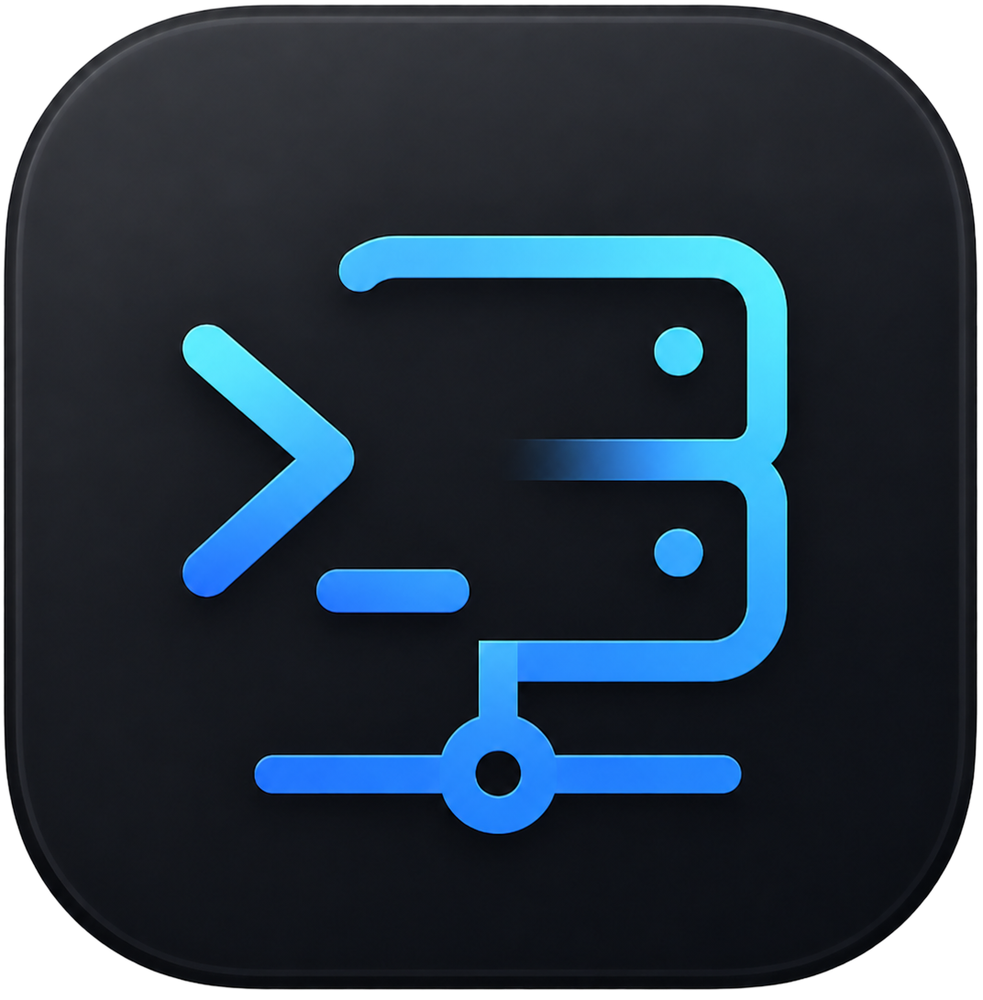

# Perms

**โปรแกรมจัดการ SSH / terminal บนเดสก์ท็อป พร้อม AI agent ในตัว — ทำงาน offline, ข้อมูลอยู่ในเครื่องล้วน**

### [⬇️ ดาวน์โหลดเวอร์ชันล่าสุด](https://github.com/pepcompat/perms-desktop/releases/latest)

**ภาษาไทย** · [English](#english)

---

รีโปนี้เป็น **ที่ดาวน์โหลดตัวติดตั้ง (installer)** ของ Perms เท่านั้น
โค้ด (open source) อยู่ที่ **[pepcompat/perms](https://github.com/pepcompat/perms)**

## ดาวน์โหลด

โหลดตัวติดตั้งตาม OS จากหน้า **[Releases](https://github.com/pepcompat/perms-desktop/releases/latest)**:

| OS | ไฟล์ |
|----|------|
| **macOS** (Apple Silicon) | `Perms-<version>-arm64.dmg` — เซ็น + notarize แล้ว |
| **Windows** | `Perms-<version>-setup.exe` |
| **Linux** | `Perms-<version>.AppImage` หรือ `Perms-<version>.deb` |

> เมื่อติดตั้งแล้ว แอปจะ **อัปเดตตัวเองอัตโนมัติ** เมื่อมีเวอร์ชันใหม่

## Perms ทำอะไรได้

- 🔐 **จัดการ SSH ครบทุกแบบ** — password / private key / ssh-agent / **jump host (bastion)** · จัดกลุ่มได้
- 🖥️ **Terminal** ทั้ง SSH และ local shell หลาย tab พร้อมกัน
- 🤖 **AI agent 3 โหมด** (แนะนำ / อนุมัติก่อนรัน / agentic) รองรับ **OpenAI, Anthropic, Google**
- 📁 **SFTP + แก้ไฟล์บนเซิร์ฟเวอร์** (เช่น `.env`) พร้อม syntax highlight, undo/redo, บันทึก `⌘S`
- 📚 **คลังความรู้** (AI จำสิ่งที่สอน) + **Runbooks** + ประวัติคำสั่ง
- ✨ **"ถาม AI ว่าทำไมพัง"** คลิกเดียว ให้ AI ช่วยหาสาเหตุและวิธีแก้

## ความปลอดภัย & ความเป็นส่วนตัว

- ความลับ (API key, SSH password) เข้ารหัสด้วย **OS keychain** — ไม่เก็บ plaintext
- ข้อมูลทั้งหมดอยู่ใน **เครื่องคุณ** (local database) ไม่ส่งออก
- คุยกับ AI = ส่งไป **provider ที่คุณเลือก** ด้วย **API key ของคุณเอง** และระบบ **กรองความลับออกก่อนส่ง**
- โหมด agentic **ถามยืนยันก่อนรันคำสั่งอันตราย**

## หมายเหตุการติดตั้ง

- **macOS**: เปิดครั้งแรกถ้าเจอเตือน ให้คลิกขวา → Open (แอปเซ็น + notarize แล้ว)
- **Windows**: ตัวติดตั้งยังไม่ได้เซ็น — SmartScreen อาจเตือน → กด *More info → Run anyway*
- **Linux (AppImage)**: `chmod +x Perms-*.AppImage` แล้วรันได้เลย

## License

[MIT](https://github.com/pepcompat/perms/blob/main/LICENSE) © pepcompat · โค้ด: [pepcompat/perms](https://github.com/pepcompat/perms)

---

# 🇬🇧 English

**Perms** is a desktop **SSH / terminal manager with a built-in AI agent** —
everything runs locally, your data never leaves your machine.

This repository only hosts the **installers**. The source code (open source) lives at
**[pepcompat/perms](https://github.com/pepcompat/perms)**.

## Download

Get the installer for your OS from **[Releases](https://github.com/pepcompat/perms-desktop/releases/latest)**:

| OS | File |
|----|------|
| **macOS** (Apple Silicon) | `Perms-<version>-arm64.dmg` — signed + notarized |
| **Windows** | `Perms-<version>-setup.exe` |
| **Linux** | `Perms-<version>.AppImage` or `Perms-<version>.deb` |

> Once installed, the app **updates itself** when a new version is released.

## What Perms can do

- 🔐 **Full SSH support** — password / private key / ssh-agent / **jump host (bastion)**, with groups
- 🖥️ **Terminal** for SSH and local shells in multiple tabs
- 🤖 **AI agent, 3 modes** (suggest / approve before running / agentic) with **OpenAI, Anthropic, Google**
- 📁 **SFTP + file editor** — browse, upload, download, zip/unzip, download whole folders, and edit files such as `.env` with syntax highlighting
- 🐳 **Docker manager** — containers grouped by compose stack, start/stop/restart/logs, terminal into a container
- 📚 **Knowledge base**, **runbooks**, command history
- ✨ **"Ask AI why it failed"** in one click

## Security & privacy

- Secrets (API keys, SSH passwords) are encrypted with the **OS keychain** — never plaintext
- All data stays in a **local database** on your machine
- AI messages go only to the **provider you choose**, with **your own API key**, and secrets are **redacted before sending**
- Agentic mode **asks before running destructive commands**

## Install notes

- **macOS**: if you see a warning on first launch, right-click → Open (the app is signed + notarized)
- **Windows**: the installer is not code-signed yet — SmartScreen may warn → *More info → Run anyway*
- **Linux (AppImage)**: `chmod +x Perms-*.AppImage` then run it

## License

[MIT](https://github.com/pepcompat/perms/blob/main/LICENSE) © pepcompat ·
Source: [pepcompat/perms](https://github.com/pepcompat/perms)
